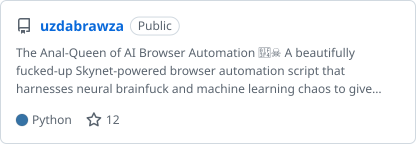
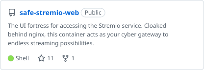
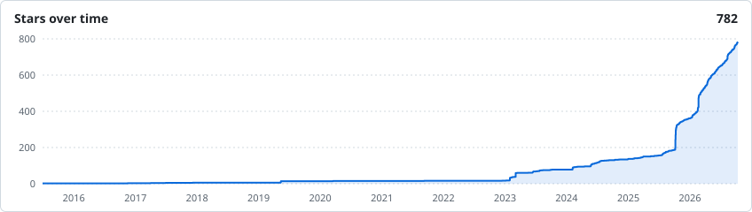

<!-- top-repos:start -->
<a href="https://github.com/psyb0t/piraterf"><picture><source media="(prefers-color-scheme: dark)" srcset="cards/piraterf-dark.svg"></picture></a> <a href="https://github.com/psyb0t/docker-stealthy-auto-browse"><picture><source media="(prefers-color-scheme: dark)" srcset="cards/docker-stealthy-auto-browse-dark.svg"></picture></a>
<a href="https://github.com/psyb0t/offgrid-tools"><picture><source media="(prefers-color-scheme: dark)" srcset="cards/offgrid-tools-dark.svg"></picture></a> <a href="https://github.com/psyb0t/safe-stremio"><picture><source media="(prefers-color-scheme: dark)" srcset="cards/safe-stremio-dark.svg"></picture></a>
<a href="https://github.com/psyb0t/mt5-httpapi"><picture><source media="(prefers-color-scheme: dark)" srcset="cards/mt5-httpapi-dark.svg"></picture></a> <a href="https://github.com/psyb0t/docker-claudebox"><picture><source media="(prefers-color-scheme: dark)" srcset="cards/docker-claudebox-dark.svg"></picture></a>
<a href="https://github.com/psyb0t/docker-planesnitch"><picture><source media="(prefers-color-scheme: dark)" srcset="cards/docker-planesnitch-dark.svg"></picture></a> <a href="https://github.com/psyb0t/aigate"><picture><source media="(prefers-color-scheme: dark)" srcset="cards/aigate-dark.svg"></picture></a>
<a href="https://github.com/psyb0t/persistent-sshfs"><picture><source media="(prefers-color-scheme: dark)" srcset="cards/persistent-sshfs-dark.svg"></picture></a> <a href="https://github.com/psyb0t/ssh-tunnel-swarm"><picture><source media="(prefers-color-scheme: dark)" srcset="cards/ssh-tunnel-swarm-dark.svg"></picture></a>
<a href="https://github.com/psyb0t/uzdabrawza"><picture><source media="(prefers-color-scheme: dark)" srcset="cards/uzdabrawza-dark.svg"></picture></a> <a href="https://github.com/psyb0t/safe-stremio-web"><picture><source media="(prefers-color-scheme: dark)" srcset="cards/safe-stremio-web-dark.svg"></picture></a>
<!-- top-repos:end -->

<!-- history:start -->
<picture><source media="(prefers-color-scheme: dark)" srcset="charts/stars-dark.svg"></picture>
<!-- history:end -->
