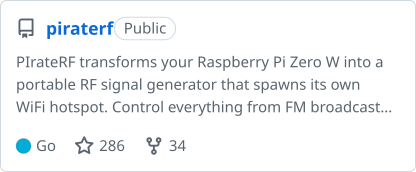
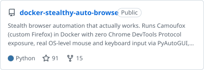
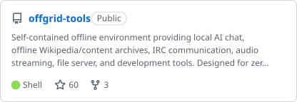
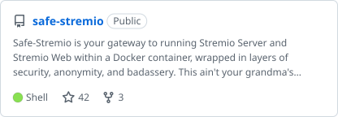
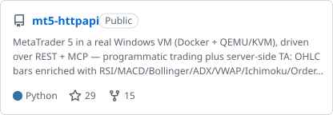
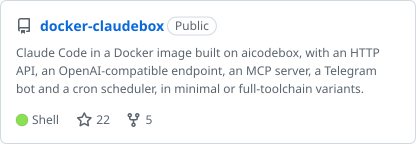
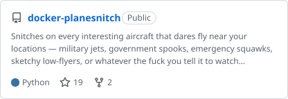
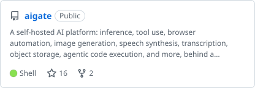
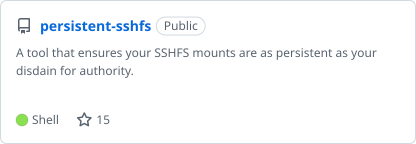
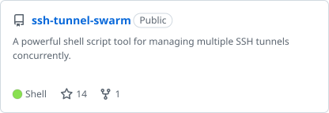

<!-- top-repos:start -->
<a href="https://github.com/psyb0t/piraterf"><picture><source media="(prefers-color-scheme: dark)" srcset="cards/piraterf-dark.svg"></picture></a> <a href="https://github.com/psyb0t/docker-stealthy-auto-browse"><picture><source media="(prefers-color-scheme: dark)" srcset="cards/docker-stealthy-auto-browse-dark.svg"></picture></a>
<a href="https://github.com/psyb0t/offgrid-tools"><picture><source media="(prefers-color-scheme: dark)" srcset="cards/offgrid-tools-dark.svg"></picture></a> <a href="https://github.com/psyb0t/safe-stremio"><picture><source media="(prefers-color-scheme: dark)" srcset="cards/safe-stremio-dark.svg"></picture></a>
<a href="https://github.com/psyb0t/mt5-httpapi"><picture><source media="(prefers-color-scheme: dark)" srcset="cards/mt5-httpapi-dark.svg"></picture></a> <a href="https://github.com/psyb0t/docker-claudebox"><picture><source media="(prefers-color-scheme: dark)" srcset="cards/docker-claudebox-dark.svg"></picture></a>
<a href="https://github.com/psyb0t/docker-planesnitch"><picture><source media="(prefers-color-scheme: dark)" srcset="cards/docker-planesnitch-dark.svg"></picture></a> <a href="https://github.com/psyb0t/aigate"><picture><source media="(prefers-color-scheme: dark)" srcset="cards/aigate-dark.svg"></picture></a>
<a href="https://github.com/psyb0t/persistent-sshfs"><picture><source media="(prefers-color-scheme: dark)" srcset="cards/persistent-sshfs-dark.svg"></picture></a> <a href="https://github.com/psyb0t/ssh-tunnel-swarm"><picture><source media="(prefers-color-scheme: dark)" srcset="cards/ssh-tunnel-swarm-dark.svg"></picture></a>
<!-- top-repos:end -->

<!-- categories:start -->
### AI coding agents

- [docker-claudebox](https://github.com/psyb0t/docker-claudebox) · Shell · ★ 23 · 5 forks: Claude Code in a Docker image built on aicodebox, with an HTTP API, an OpenAI-compatible endpoint, an MCP server, a Telegram bot and a cron scheduler, in minimal or full-toolchain variants.
- [docker-pibox](https://github.com/psyb0t/docker-pibox) · Shell · ★ 3: pi-coding-agent in a Docker image built on aicodebox, with an HTTP API, an OpenAI-compatible endpoint, an MCP server, a Telegram bot and a cron scheduler.
- [codex-plugin-loop](https://github.com/psyb0t/codex-plugin-loop) · Makefile · ★ 1: Codex CLI plugin that repeats instructions at a fixed interval in an open session. Holds one turn open on the clock.sleep tool, resumes itself when the turn gets killed, and stops only on an explicit $loop:stop.
- [agents](https://github.com/psyb0t/agents): One marketplace for every psyb0t agent skill and plugin, installable from Claude Code and Codex.
- [docker-aicodebox](https://github.com/psyb0t/docker-aicodebox) · Python: Base Docker image that wraps any terminal AI coding agent in an HTTP API, an OpenAI-compatible endpoint, an MCP server, a Telegram bot and a cron scheduler through a short adapter.
- [docker-codexbox](https://github.com/psyb0t/docker-codexbox) · Shell: OpenAI Codex CLI in a Docker image built on aicodebox, with an HTTP API, an OpenAI-compatible endpoint, an MCP server, a Telegram bot and a cron scheduler, in minimal or full-toolchain variants.
- [peen](https://github.com/psyb0t/peen) · Go: Coding agent built as a server: open any project from the browser UI, the peen command line, a GitHub Action, or over WebSocket. Each project runs in its own process or container, follows its AGENTS.md, rules, skills and hooks, survives restarts and crashes, and every tool call and model exchange lands in SQLite.

### Self-hosted AI services

- [aigate](https://github.com/psyb0t/aigate) · Shell · ★ 17 · 3 forks: A self-hosted AI platform: inference, tool use, browser automation, image generation, speech synthesis, transcription, object storage, agentic code execution, and more, behind a single OpenAI-compatible endpoint. One docker-compose up.
- [docker-talkies](https://github.com/psyb0t/docker-talkies) · Python · ★ 7 · 5 forks: Self-hosted Docker speech API for OpenAI-compatible transcription and text-to-speech, streaming ASR, voice cloning, phoneme recognition, and MCP.
- [cli-llm-chat](https://github.com/psyb0t/cli-llm-chat) · Python · ★ 5: Welcome to the digital thunderdome, you keyboard-smashing lunatics! This ain't your grandma's chatbot, it's a CLI-powered, LLM-fueled beast! And guess what? It also supports Telegram integration right out of the box. Get ready to unleash the madness!
- [docker-audiolla](https://github.com/psyb0t/docker-audiolla) · Python · ★ 5 · 3 forks: Self-hosted audio API in one Docker container. Stem separation, mastering, MIR (BPM/key/chords), audio→MIDI, text-to-music + SFX (MusicGen/Stable Audio/Riffusion/AudioLDM2), diarization, speech enhancement, restoration, embeddings + zero-shot tagging, workflows, async + webhooks. REST + MCP. CPU + CUDA.
- [docker-qwenspeak](https://github.com/psyb0t/docker-qwenspeak) · Python · ★ 4: Qwen3-TTS over SSH. Pick a voice, clone a voice, design a voice - all through a YAML config piped via stdin. Models run locally, no API keys, no cloud bullshit.
- [decidealot](https://github.com/psyb0t/decidealot) · Python · ★ 3: Make the call. Run local Laya, Von, CLM or hosted Jev for typed classification and scoring through one HTTP and MCP API, with resource-aware batches.
- [docker-predictalot](https://github.com/psyb0t/docker-predictalot) · Python · ★ 3: Self-hosted forecasting + prediction service. Five zero-shot time-series foundation models (Chronos-2, TimesFM 2.5, Moirai-2, Toto-1, Sundial) across six forecast types, plus nine supervised tabular ML backends (LightGBM, XGBoost, sklearn family) with calibrated / stacking / diversified meta-learners. Unified REST API + MCP server.
- [2xbrainz](https://github.com/psyb0t/2xbrainz) · Python · ★ 1: A second brain for conversations you're already having: listens to your mic and system audio as two separate streams, transcribes both live, works out when the other side shut up, and hands you a reply draft before you panic. It drafts, never sends or speaks for you. Alpha: live capture is Linux/PipeWire only.
- [chatz](https://github.com/psyb0t/chatz) · Go · ★ 1: Self-hosted AI chat that deploys as one Go binary. Streaming SSE, OpenAI and Anthropic upstreams, MCP tools, and generative UI that renders live charts and components from model output. Postgres or SQLite.
- [docker-flickies](https://github.com/psyb0t/docker-flickies) · Python · ★ 1 · 1 fork: Self-hosted video API in one Docker container. Lipsync (LatentSync 1.5, Wav2Lip), face restoration (GFPGAN), ffmpeg ops (trim/concat/transcode/scale/mux/extract/thumbnail/gif), ffprobe metadata, async jobs + webhooks. REST + MCP. CPU + CUDA. Drive from shell, generated Go/Python clients, or LLM agent.
- [ollama-chat-party](https://github.com/psyb0t/ollama-chat-party) · Python · ★ 1: Multi-user AI-powered RAG beast that lets everyone talk to the same LLM simultaneously!
- [torchbase](https://github.com/psyb0t/torchbase) · Python: Pinned PyTorch CPU and CUDA base images. Build the damn stack once.

### Browser and device automation

- [docker-stealthy-auto-browse](https://github.com/psyb0t/docker-stealthy-auto-browse) · Python · ★ 94 · 16 forks: Stealth browser automation that actually works. Runs Camoufox (custom Firefox) in Docker with zero Chrome DevTools Protocol exposure, real OS-level mouse and keyboard input via PyAutoGUI, and a JSON HTTP API + MCP server to control it all remotely. Watch it live via noVNC.
- [uzdabrawza](https://github.com/psyb0t/uzdabrawza) · Python · ★ 12: The Anal-Queen of AI Browser Automation 🏴‍☠️ A beautifully fucked-up Skynet-powered browser automation script that harnesses neural brainfuck and machine learning chaos to give zero shits about anything while somehow still working perfectly.
- [android-lab](https://github.com/psyb0t/android-lab) · Shell: Build Android shit, boot a private emulator and poke its UI through Docker. Keep the SDK off your host.
- [dikciz-launcher](https://github.com/psyb0t/dikciz-launcher) · Kotlin: Programmable Android launcher with native pages, HTML widgets, Lua automation, and WebSocket/MCP phone control over USB, Wi-Fi, or Tailscale.

### Trading

- [mt5-httpapi](https://github.com/psyb0t/mt5-httpapi) · Python · ★ 31 · 15 forks: MetaTrader 5 in a real Windows VM (Docker + QEMU/KVM), driven over REST + MCP: programmatic trading plus server-side TA. OHLC bars enriched with RSI/MACD/Bollinger/ADX/VWAP/Ichimoku/Order Blocks/FVGs (primitives, not signals). Typed MCP tools mirror the whole surface. Multi-broker, multi-account. No Wine bullshit.
- [docker-wickworks](https://github.com/psyb0t/docker-wickworks) · Python · ★ 5 · 2 forks: Dumb-as-rocks OHLC analyzer. POST your bars + the indicators you want, get back exactly what you asked for. RSI/MACD/Bollinger/ADX/ATR/VWAP/Ichimoku, plus SMC primitives: Order Blocks, FVGs, BOS/CHoCH, swing structure. Stateless HTTP + MCP, no database, no AI-powered signals, no $97/mo Discord upsell.
- [docker-mql-compiler](https://github.com/psyb0t/docker-mql-compiler) · Shell · ★ 1: Compile MQL4 and MQL5 on Linux: MetaEditor under Wine in Docker, one command, compile errors in your terminal.
- [ibkr-httpapi](https://github.com/psyb0t/ibkr-httpapi) · Python · ★ 1: Interactive Brokers, curl-friendly, over REST + MCP. FastAPI + ib_async over a Linux-native IB Gateway: stocks/options/futures/forex/crypto/CFD contracts, quotes, historical bars, orders, positions, executions. Typed MCP tools mirror the whole surface. The IBKR half of mt5-httpapi: same shape, no Windows VM.
- [MQL4-Utils](https://github.com/psyb0t/MQL4-Utils) · MQL5 · ★ 1: Header files to make life easier when building expert advisors for MetaTrader4 in MQL4

### Code generation

- [gen-asyncapi](https://github.com/psyb0t/gen-asyncapi) · Go: Generates Go or TypeScript types, strict validation, union types and a WebSocket client from AsyncAPI 3 specs.
- [oapixconstgen](https://github.com/psyb0t/oapixconstgen) · Go: Go tool that generates typed Go constants from the x-constants extension in OpenAPI specs, keeping spec and code in sync.

### Go libraries and tooling

- [gofindimpl](https://github.com/psyb0t/gofindimpl) · Go · ★ 3: Hunt down Go interface implementations like a bloodhound with trust issues. Tired of grep-ing through thousands of lines trying to figure out which structs actually implement that damn interface? This tool does the heavy lifting so you don't have to suffer through another existential crisis at 3am.
- [servicepack](https://github.com/psyb0t/servicepack) · Go · ★ 3 · 1 fork: Clone-and-own Go service framework for concurrent services: run them together locally, then deploy as one binary or split them into microservices, with retries, dependencies, graceful shutdown, and scoped logs.
- [aichteeteapee](https://github.com/psyb0t/aichteeteapee) · Go · ★ 1: Pronounced "HTTP" - because sometimes the best fucking code comes with wordplay. A Go library that does everything you need and nothing you don't. Spin up a production-ready server with middleware, WebSocket hubs, file uploads, static serving, request proxying with caching, and OpenAPI validation.
- [ctxerrors](https://github.com/psyb0t/ctxerrors) · Go · ★ 1: A Go library that wraps errors with context information (file, line, function) because debugging without context is like trying to find your dick in the dark.
- [elelem](https://github.com/psyb0t/elelem) · Go · ★ 1: A Go engine for talking to LLMs that doesn't give a shit which one. Streaming, tool loops, history that actually fits the context window, retries that don't repeat themselves, and typed structured output. Swap OpenAI for Anthropic by changing one line. Library, not a framework: you own the loop.
- [essessey](https://github.com/psyb0t/essessey) · Go · ★ 1: Stream an LLM turn to a client over SSE, NATS or WebSocket. One event model, no transport dependencies.
- [go-config-parser](https://github.com/psyb0t/go-config-parser) · Go · ★ 1: A Go wrapper package for reading and unmarshalling data from configuration files based on Viper.
- [vibecheck](https://github.com/psyb0t/vibecheck) · Go · ★ 1: Turn messy state into typed, auditable classifications, scores, and policy decisions over REST and MCP.
- [commander](https://github.com/psyb0t/commander) · Go: Commander wraps os/exec into something that doesn't make you want to fucking quit programming: proper process lifecycle management, real-time output streaming, graceful termination, and a mock system for testing.
- [common-go](https://github.com/psyb0t/common-go) · Go: Shared Go building blocks for psyb0t services: error sentinels, cache, DB, queues, rate limiting, a legacy Loki slog sink (superseded by github.com/psyb0t/slogging), Temporal, and LLM utilities.
- [ctxscope](https://github.com/psyb0t/ctxscope) · Go: Pin log attributes to a context.Context and every line under it carries them. Set request_id once at the door instead of dragging it through twenty functions that don't give a shit about it.
- [go-asyncapi](https://github.com/psyb0t/go-asyncapi) · Go: Loads AsyncAPI 3 documents in Go: servers, channels, operations and messages, with $refs followed across files and traits merged.
- [goenv](https://github.com/psyb0t/goenv) · Go · 1 fork: The most over-engineered environment variable reader in the history of Go programming. A full-blown, battle-tested, enterprise-grade package that reads ONE environment variable and tells you if you're in prod or dev.
- [gonfiguration](https://github.com/psyb0t/gonfiguration) · Go: Config loading with zero fluff. Because ain't nobody got time for overcomplicated crap. Unleash the gonfiguration beast!
- [procscope](https://github.com/psyb0t/procscope) · Go: Let a Go process profile itself (CPU, heap, goroutines, blocking) and get the answer back as a value instead of serving pprof on a port nobody should be exposing.
- [slogging](https://github.com/psyb0t/slogging) · Go: Everything for Go's stdlib log/slog in one place: configure it from the environment, plus handlers that ship logs to Loki or keep them searchable in memory. Spiritual successor to logrus-configurator.

### Radio and hardware

- [piraterf](https://github.com/psyb0t/piraterf) · Go · ★ 286 · 35 forks: PIrateRF transforms your Raspberry Pi Zero W into a portable RF signal generator that spawns its own WiFi hotspot. Control everything from FM broadcasts to digital modes through your browser - hack the airwaves from anywhere! 📡⚡
- [docker-planesnitch](https://github.com/psyb0t/docker-planesnitch) · Python · ★ 20 · 2 forks: Snitches on every interesting aircraft that dares fly near your locations: military jets, government spooks, emergency squawks, sketchy low-flyers, or whatever the fuck you tell it to watch for. Monitor multiple locations at once: your house, your office, grandma's house, Area 51, whatever.
- [adsb-publisher-setup](https://github.com/psyb0t/adsb-publisher-setup) · Shell · ★ 1 · 2 forks: One-script setup for receiving ADS-B aircraft data with an RTL-SDR dongle and publishing it to multiple flight tracking aggregators simultaneously.  Deploys a Docker Compose stack with automatic configuration, SDR detection, and optional Grafana dashboards.
- [gorpitx](https://github.com/psyb0t/gorpitx) · Go · 1 fork: Go wrapper for rpitx: subprocess-managed RF transmission via a singleton. Covers FM/RDS, Morse, POCSAG, FT8, SSTV, RTTY, FSK, IQ and more (12 modules). Dev-mode mocks execution so you can test without keying an actual transmitter.
- [marlinfw-tools](https://github.com/psyb0t/marlinfw-tools) · Python: Talk straight to a Marlin 3D printer over USB serial from a locked-down Docker container: dump firmware, settings, temps and endstops, record live state, list and run SD card prints, and change one setting when you mean it. No vendor cloud, no host Python.

### Self-hosted services and MCP servers

- [docker-hybrids3](https://github.com/psyb0t/docker-hybrids3) · Shell · ★ 5 · 1 fork: Lightweight object storage that speaks S3 (boto3/AWS SDK compatible), plain HTTP, and MCP. SQLite for metadata, flat files on disk.
- [docker-mailbox](https://github.com/psyb0t/docker-mailbox) · Python · ★ 5 · 4 forks: Self-hosted HTTP API and MCP server that reads, organizes, drafts, replies to and sends mail across multiple IMAP/SMTP accounts, with per-token scopes, send limits, an audit log and signed new-mail webhooks.
- [docker-telethon-plus](https://github.com/psyb0t/docker-telethon-plus) · Python · ★ 5 · 1 fork: Your Telegram account, but it takes HTTP requests. Wraps Telethon, the real MTProto userbot client, not that neutered Bot API garbage, behind a JSON HTTP API and a Model Context Protocol endpoint.
- [docker-reverse-engineer-anything](https://github.com/psyb0t/docker-reverse-engineer-anything) · TypeScript · ★ 4 · 1 fork: REA (Reverse Engineer Anything) in Docker: Android APK decompilation with JADX, Apktool and adb built in, Ghidra on demand, behind a token-guarded Streamable HTTP MCP endpoint. Also stdio MCP and a CLI.
- [docker-lockbox](https://github.com/psyb0t/docker-lockbox) · Shell · ★ 1: Locked-down SSH container with sandboxed file operations. Use as a base image to build your own dedicated tool containers - just provide a list of allowed commands and install your binaries. No shell access, no injection bullshit.
- [docker-proxq](https://github.com/psyb0t/docker-proxq) · Go · ★ 1: proxq - The honey badger of HTTP proxies. Takes your request, throws it in a Redis-backed job queue, and deals with it when it damn well pleases. You get a job ID back instantly, so come back later to pick up the goods.
- [docker-mediaproc](https://github.com/psyb0t/docker-mediaproc) · Shell: Containerized media processing tools over SSH. Drop files in, run ffmpeg/sox/imagemagick over SSH, get your shit out. No shell access, no bullshit - just a locked-down Python wrapper that only lets you run what you're supposed to run.
- [docker-monero](https://github.com/psyb0t/docker-monero) · Go: Monero node and programmatic wallets over HTTP and MCP, in one Docker container.
- [gitrakz](https://github.com/psyb0t/gitrakz) · Go: Self-hosted GitHub activity tracker that syncs your gh activity into SQLite and runs template-driven timeline, session, and report views.
- [rankrat](https://github.com/psyb0t/rankrat) · Python: Self-hosted MCP and REST server that audits, monitors and manages sites you control across Search Console, Bing Webmaster, GA4, Tag Manager, Clarity, Cloudflare, PageSpeed and CrUX.

### Privacy, offline and networking

- [offgrid-tools](https://github.com/psyb0t/offgrid-tools) · Shell · ★ 62 · 4 forks: Self-contained offline environment providing local AI chat, offline Wikipedia/content archives, IRC communication, audio streaming, file server, and development tools. Designed for zero internet dependency - download once, run anywhere. Perfect for remote areas, emergency scenarios, or escaping surveillance capitalism.
- [safe-stremio](https://github.com/psyb0t/safe-stremio) · Shell · ★ 42 · 3 forks: Safe-Stremio is your gateway to running Stremio Server and Stremio Web within a Docker container, wrapped in layers of security, anonymity, and badassery. This ain't your grandma's streaming setup. This is for digital pirates and cyberpunks who value privacy and control.
- [safe-stremio-web](https://github.com/psyb0t/safe-stremio-web) · Shell · ★ 11 · 1 fork: The UI fortress for accessing the Stremio service. Cloaked behind nginx, this container acts as your cyber gateway to endless streaming possibilities.
- [safe-transmission](https://github.com/psyb0t/safe-transmission) · Shell · ★ 8: The ultimate fusion of security and torrenting, designed for the gritty streets of the cyberpunk future. This Docker image mashes together OpenVPN, Transmission, and Nginx, creating a fortified fortress for your torrent traffic. With built-in optional rate-limited HTTP basic authentication, you can fend off those pesky netrunners, and optional VPN
- [docker-openvpn-client](https://github.com/psyb0t/docker-openvpn-client) · Shell · ★ 5: Welcome to the most badass OpenVPN Client Docker image you'll ever see. This ain't your grandma's VPN setup. It's sleek, it's stealthy, and it’s ready to serve your rebellious needs.
- [docker-torssh](https://github.com/psyb0t/docker-torssh) · Shell · ★ 1: Connect to TOR SSH hidden services from a docker container.
- [pr0xteus](https://github.com/psyb0t/pr0xteus) · Go: On-demand WireGuard exit pools with short-lived SOCKS5 and HTTP proxy leases for self-hosted clients, containers, and Tailscale.

### Sysadmin and DevOps

- [persistent-sshfs](https://github.com/psyb0t/persistent-sshfs) · Shell · ★ 15: A tool that ensures your SSHFS mounts are as persistent as your disdain for authority.
- [ssh-tunnel-swarm](https://github.com/psyb0t/ssh-tunnel-swarm) · Shell · ★ 14 · 1 fork: A powerful shell script tool for managing multiple SSH tunnels concurrently.
- [supervisor-shell-ui](https://github.com/psyb0t/supervisor-shell-ui) · Python · ★ 7: A CLI alternative to the built-in web interface of Supervisor, offering a more convenient way to manage processes directly from the terminal.
- [auto-usb-storage-mount](https://github.com/psyb0t/auto-usb-storage-mount) · Shell · ★ 6: auto-usb-storage-mount automates USB drive mounting with a config-driven approach. It mounts drives based on your rules, ensuring they're always where you expect, hassle-free. Perfect for those who prefer their storage management with a dash of anarchy.
- [supervisor-config-gen](https://github.com/psyb0t/supervisor-config-gen) · Shell · ★ 2: supervisor-config-gen is a bash script that simplifies the process of creating generic configuration files for Supervisor, allowing developers to focus on building software.
- [reusable-github-workflows](https://github.com/psyb0t/reusable-github-workflows) · Shell · ★ 1: Security-hardened reusable GitHub Actions workflows for Go, Python and Docker CI/CD: lint, test, scan, build, publish, release. Plus ClawHub skill/plugin publishing, MCP registry publish, self-rendered SVG badges, Codeberg/GitLab/Gitee mirroring, and a PR gate for non-collaborators. One uses: line, no copy-paste.
- [ez-pre-commit](https://github.com/psyb0t/ez-pre-commit) · Shell: A simple bash script to manage your pre-commit hooks in a Git repository.

### API clients

- [go-spamcheck](https://github.com/psyb0t/go-spamcheck) · Go · ★ 2: Tiny Go client for Postmark's SpamCheck API: submit a raw email, get its SpamAssassin spam score and matched-rule breakdown. No account or API key required.
- [go-bfl](https://github.com/psyb0t/go-bfl) · Shell: Unofficial Go client for the Black Forest Labs (FLUX) API, generated from the official OpenAPI spec.
- [go-browser-use](https://github.com/psyb0t/go-browser-use) · Go: Unofficial Go client for the Browser Use Cloud API, generated from the official OpenAPI spec.
- [go-btse](https://github.com/psyb0t/go-btse) · Go: Unofficial Go client for the BTSE REST and WebSocket APIs, generated from the official OpenAPI and AsyncAPI specs.
- [go-bunnynet](https://github.com/psyb0t/go-bunnynet) · Go: Unofficial Go client for the Bunny.net API, generated from the official OpenAPI spec.
- [go-calcom](https://github.com/psyb0t/go-calcom) · Shell: Unofficial Go client for the Cal.com API v2, generated from the official OpenAPI spec.
- [go-cerebras](https://github.com/psyb0t/go-cerebras) · Shell: Unofficial Go client for the Cerebras Inference API, generated from the official OpenAPI spec.
- [go-contextual-ai](https://github.com/psyb0t/go-contextual-ai) · Shell: Unofficial Go client for the Contextual AI API, generated from the official OpenAPI spec.
- [go-coolify](https://github.com/psyb0t/go-coolify) · Shell: Unofficial Go client for the Coolify API, generated from the official OpenAPI spec.
- [go-deribit](https://github.com/psyb0t/go-deribit) · Shell: Unofficial Go client for the Deribit REST and WebSocket APIs, generated from the official OpenAPI and AsyncAPI specs.
- [go-dydx-indexer](https://github.com/psyb0t/go-dydx-indexer) · Shell: Unofficial Go client for the dYdX v4 Indexer API, generated from the official OpenAPI spec.
- [go-elevenlabs](https://github.com/psyb0t/go-elevenlabs) · Shell: Unofficial Go client for the ElevenLabs API, generated from the official OpenAPI spec.
- [go-etoro](https://github.com/psyb0t/go-etoro) · Shell: Unofficial Go clients for the eToro public REST and WebSocket APIs, generated from eToro's OpenAPI and AsyncAPI specs.
- [go-exa](https://github.com/psyb0t/go-exa) · Shell: Unofficial Go client for the Exa search API, generated from the official OpenAPI spec.
- [go-fireworks](https://github.com/psyb0t/go-fireworks) · Shell: Unofficial Go client for the Fireworks AI API, generated from the official OpenAPI spec.
- [go-hubspot](https://github.com/psyb0t/go-hubspot) · Shell: Unofficial Go client for the HubSpot API, generated from the official OpenAPI spec.
- [go-ibkr](https://github.com/psyb0t/go-ibkr) · Shell: Unofficial Go client for the Interactive Brokers Web API, generated from the official OpenAPI spec.
- [go-intercom](https://github.com/psyb0t/go-intercom) · Go: Unofficial Go client for the Intercom API, generated from the official OpenAPI spec.
- [go-jina](https://github.com/psyb0t/go-jina) · Go: Unofficial Go client for the Jina AI APIs (embeddings, rerank, reader), generated from the official OpenAPI specs.
- [go-kalshi](https://github.com/psyb0t/go-kalshi) · Go: Unofficial Go client for the Kalshi REST and WebSocket APIs, generated from the official OpenAPI and AsyncAPI specs.
- [go-klavis](https://github.com/psyb0t/go-klavis) · Shell: Unofficial Go client for the Klavis AI API, generated from the official OpenAPI spec.
- [go-label-studio](https://github.com/psyb0t/go-label-studio) · Shell: Unofficial Go client for the Label Studio API, generated from the official OpenAPI spec.
- [go-latitude-llm](https://github.com/psyb0t/go-latitude-llm) · Shell: Unofficial Go client for the Latitude LLM API, generated from the official OpenAPI spec.
- [go-llama-api](https://github.com/psyb0t/go-llama-api) · Shell: Unofficial Go client for the Meta Llama API, generated from the official OpenAPI spec.
- [go-lovable](https://github.com/psyb0t/go-lovable) · Go: Unofficial Go client for the Lovable API, generated from the official OpenAPI spec.
- [go-mem0](https://github.com/psyb0t/go-mem0) · Go: Unofficial Go client for the Mem0 API, generated from the official OpenAPI spec.
- [go-mistral](https://github.com/psyb0t/go-mistral) · Shell: Unofficial Go client for the Mistral AI API, generated from the official OpenAPI spec.
- [go-morphik](https://github.com/psyb0t/go-morphik) · Shell: Unofficial Go client for the Morphik API, generated from the official OpenAPI spec.
- [go-opik](https://github.com/psyb0t/go-opik) · Shell: Unofficial Go client for the Opik API, generated from the official OpenAPI spec.
- [go-perplexity](https://github.com/psyb0t/go-perplexity) · Shell: Unofficial Go client for the Perplexity API, generated from the official OpenAPI spec.
- [go-polar](https://github.com/psyb0t/go-polar) · Shell: Unofficial Go client for the Polar API, generated from the official OpenAPI spec.
- [go-postgrid](https://github.com/psyb0t/go-postgrid) · Go: Unofficial Go client for the PostGrid print and mail API, generated from the official OpenAPI spec.
- [go-render-api](https://github.com/psyb0t/go-render-api) · Shell: Unofficial Go client for the Render API, generated from the official OpenAPI spec.
- [go-revolut-business](https://github.com/psyb0t/go-revolut-business) · Shell: Unofficial Go client for the Revolut Business API, generated from the official OpenAPI spec.
- [go-roark](https://github.com/psyb0t/go-roark) · Go: Unofficial Go client for the Roark API, generated from the official OpenAPI spec.
- [go-runway](https://github.com/psyb0t/go-runway) · Shell: Unofficial Go client for the Runway API, generated from the official OpenAPI spec.
- [go-skyvern](https://github.com/psyb0t/go-skyvern) · Shell: Unofficial Go client for the Skyvern API, generated from the official OpenAPI spec.
- [go-solana-tracker](https://github.com/psyb0t/go-solana-tracker) · Shell: Unofficial Go client for the Solana Tracker REST and WebSocket APIs, generated from the official OpenAPI and AsyncAPI specs.
- [go-supabase-management](https://github.com/psyb0t/go-supabase-management) · Shell: Unofficial Go client for the Supabase Management API, generated from the official OpenAPI spec.
- [go-surge](https://github.com/psyb0t/go-surge) · Go: Unofficial Go client for the Surge SMS API, generated from the official OpenAPI spec.
- [go-tinker](https://github.com/psyb0t/go-tinker) · Shell: Unofficial Go client for the Thinking Machines Tinker API, generated from the official OpenAPI spec.
- [go-togetherai](https://github.com/psyb0t/go-togetherai) · Go: Unofficial Go client for the Together AI API, generated from the official OpenAPI spec.
- [go-trading212](https://github.com/psyb0t/go-trading212) · Shell: Unofficial Go client for the Trading 212 API, generated from the official OpenAPI spec.
- [go-twelvedata](https://github.com/psyb0t/go-twelvedata) · Shell: Unofficial Go client for the Twelve Data API, generated from the official OpenAPI spec.
- [go-unstructured](https://github.com/psyb0t/go-unstructured) · Go: Unofficial Go client for the Unstructured platform and partition APIs, generated from the official OpenAPI specs.
- [go-valtown](https://github.com/psyb0t/go-valtown) · Shell: Unofficial Go client for the Val Town API, generated from the official OpenAPI spec.
- [go-vectara](https://github.com/psyb0t/go-vectara) · Go: Unofficial Go client for the Vectara API, generated from the official OpenAPI spec.
- [go-vercel](https://github.com/psyb0t/go-vercel) · Shell: Unofficial Go client for the Vercel REST API, generated from the official OpenAPI spec.
- [go-weave](https://github.com/psyb0t/go-weave) · Shell: Unofficial Go client for the W&B Weave API, generated from the official OpenAPI spec.
- [go-writer-ai](https://github.com/psyb0t/go-writer-ai) · Shell: Unofficial Go client for the Writer API, generated from the official OpenAPI spec.
- [go-xai](https://github.com/psyb0t/go-xai) · Shell: Unofficial Go client for the xAI (Grok) API, generated from the official OpenAPI spec.
- [go-zeroentropy](https://github.com/psyb0t/go-zeroentropy) · Go: Unofficial Go client for the ZeroEntropy API, generated from the official OpenAPI spec.
- [go-zulip](https://github.com/psyb0t/go-zulip) · Go Template: Unofficial Go client for the Zulip API, generated from the official OpenAPI spec.
<!-- categories:end -->
